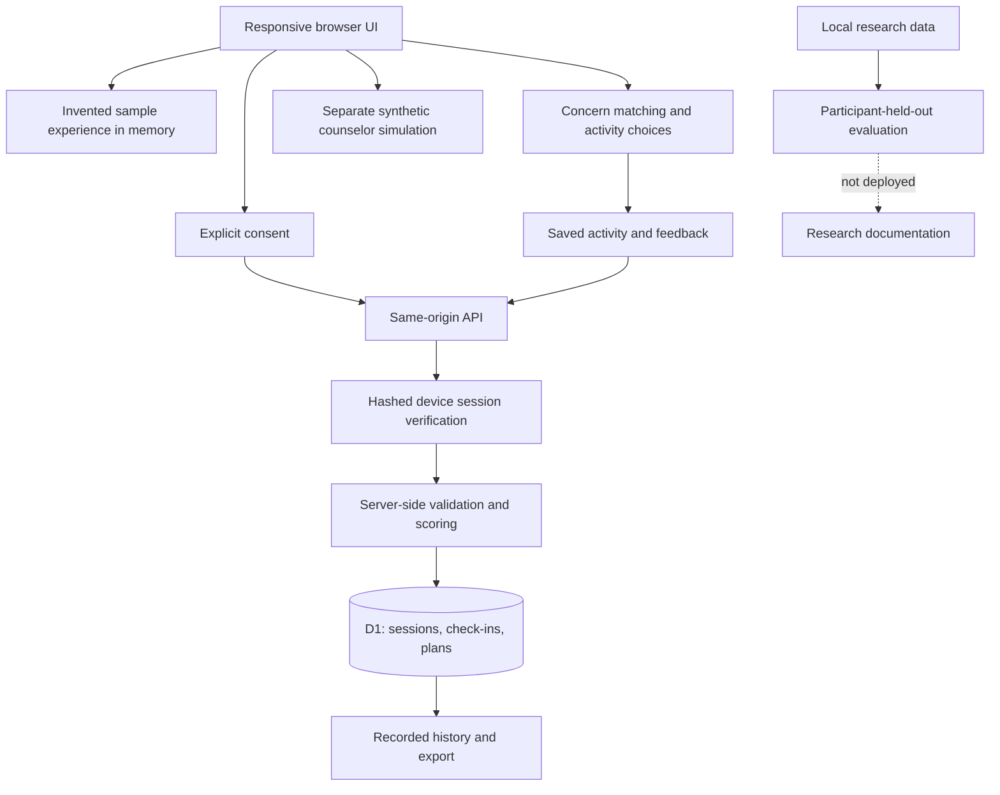

# System architecture

Saathi separates deterministic screening, recorded trends, support preferences, and human workflow simulation. The deployment is a single Worker with static assets and one D1 database. This is intentionally small enough to inspect and operate for an academic demonstration.

## API contract

| Route | Method | Authorization | Behavior |
|---|---|---|---|
| `/api/health` | GET | Public | Reports service mode and whether the D1 binding exists; not a database-readiness probe |
| `/api/session` | POST | Same-origin, current consent version | Creates a 30-day session and sets an HttpOnly cookie |
| `/api/me` | GET | Unexpired session cookie | Returns only the session's records and activity progress |
| `/api/checkins` | POST | Session and same-origin | Validates inputs, recomputes scores and stores server timestamp |
| `/api/plans` | POST | Session and same-origin | Updates one allowlisted activity's progress |
| `/api/me` | DELETE | Session and same-origin | Deletes active session and related records, then expires cookie |

All JSON responses use `Cache-Control: no-store`. Input bodies are limited to 8 KiB by actual streamed size. No client-provided session identifier, timestamp, score or support flag is trusted. The database uses bound parameters. A 500-record cap limits each private space; it is not a substitute for account-level abuse protection.

## Session design

The server creates a cryptographically random 256-bit token and stores its SHA-256 hash. The token stays in an HttpOnly, same-site cookie. HTTPS adds the Secure flag. There are no passwords, email addresses, or third-party identity providers.

This design supports private records on one browser. It deliberately does not offer identity verification, account recovery, cross-device syncing, or clinician accounts. Anyone with access to the same unlocked browser profile may access that space. The UI warns against shared devices. A future institution-operated version should use a vetted identity provider, staff role checks and explicit per-user sharing grants.

## Retention and deletion

Sessions expire 30 days after creation; reads after expiry fail even if cleanup has not run yet. A daily cron and new-session creation remove expired sessions. Foreign-key cascades remove related check-ins and plans. User deletion does the same immediately in the active database. Hosting backups and provider metadata have independent retention policies. Do not describe active deletion as guaranteed immediate erasure of all backups.

## Safety boundary

PHQ-9 item 9 greater than zero shows support guidance independently of the summed band. The code does not infer imminent danger, send an alert, or dispatch services. Every page has a support button stating that the app is not monitored. No helpline number is guessed or embedded.

Scoring rules are deterministic and versioned. The optional screening questionnaires refer to the previous two weeks. The daily reflection is an informal personal measure and must not be described as a validated diagnostic instrument. Sleep changes and mood movements are descriptive; the app makes no causal claims.

## Counselor workflow

The demo queue contains three invented cases. Updates are browser-memory-only and visibly labeled as simulation. It has no endpoint that exposes live check-ins. Production requirements include staff authentication, role authorization, consented sharing, case assignment, acknowledgments, escalation timeouts, deduplication, audit records, verified referral destinations and a staffed response commitment. None of these are silently simulated as working real-world services.

## Operational limits

- Cloudflare HTTPS handles transport encryption; hosting administrators still have database access.
- No sensitive request-body logging is implemented. The deployed dashboard retains Cloudflare invocation logs for operational monitoring; provider metadata has separate retention. No application analytics or questionnaire logging is implemented.
- Security headers restrict scripts, styles and connections to the same origin and disable framing, camera, microphone and geolocation.
- There is no distributed abuse limiter, CAPTCHA, incident monitoring or account recovery. Configure appropriate edge rate limits and monitoring before an open recruitment pilot.
- Provider quotas and billing are controlled by the Cloudflare account. No paid plan upgrades are part of this deployment.
- Database schema changes require migrations. Back up before future destructive migrations.
- `scheduled` cleanup requires the cron trigger in `wrangler.jsonc`; it is not run by the local development adapter.
- Deployment rollback is a Worker-version operation; it does not automatically roll back database migrations.

## Verification

Automated tests cover scoring boundaries, incomplete and malicious inputs, server-side recomputation, consent, origin checks, session isolation, expiry, active deletion, cascade behavior, and unavailable database configuration. Local tests use SQLite with foreign keys enabled. They do not establish clinical validity, prove fairness, or replace production D1 smoke tests.
